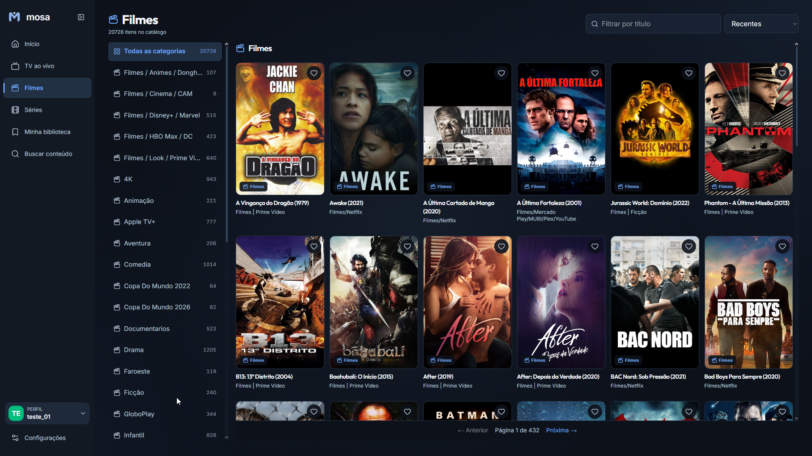
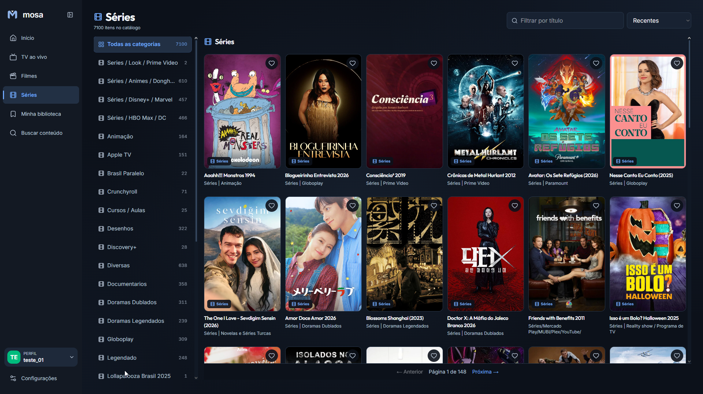
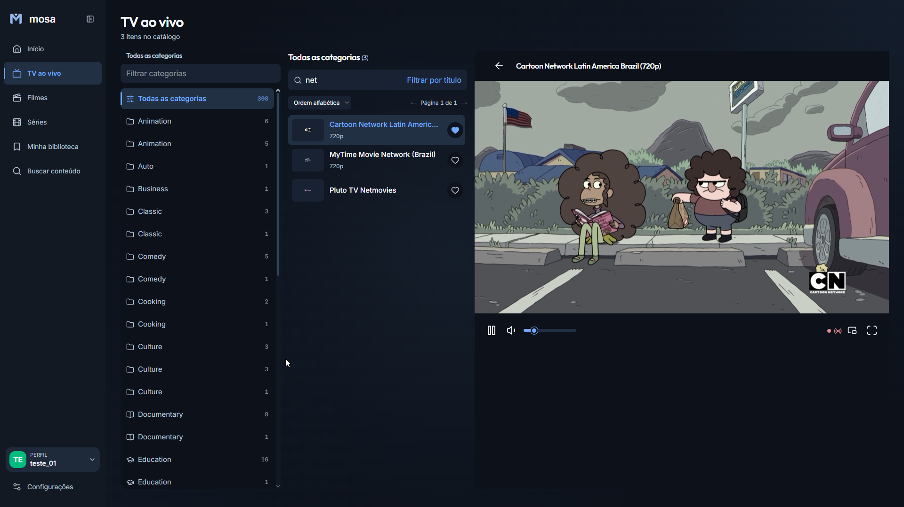
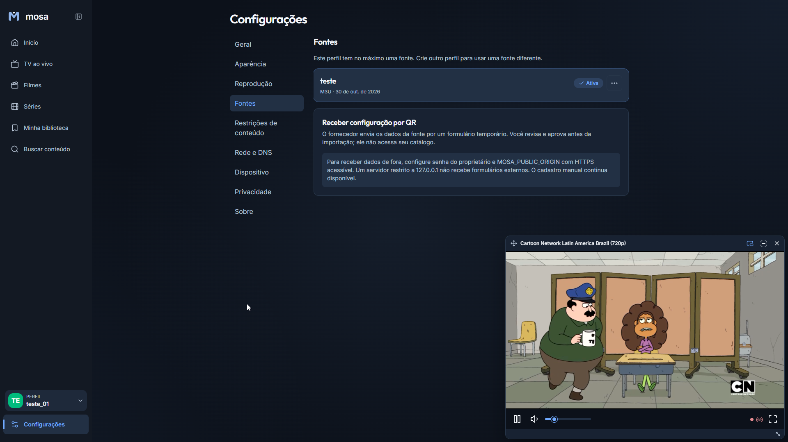

# Mosa


**Your own TV and video catalog, in one place.** Mosa connects sources you are authorized to use and gives you a clean interface for live TV, movies, series, favorites, and watch history. It **does not provide playlists, subscriptions, or streams**.

## What you can do

### Browse your collection

Add an Xtream account or an M3U playlist (URL or local file). Mosa imports titles and categories into a local catalog so you can search, sort, and save favorites. Each profile has at most one source; previously configured Stalker/MAG sources remain available.



Movies show details when selected. Series start with collapsed seasons; open one or several and browse episodes horizontally. The catalog and any artwork come from the source you connected, not from Mosa.



### Watch live TV

Filter channels automatically after you stop typing, switch categories, and watch the preview alongside the list. On a phone, the preview stays visible while you scroll channels. Playback progress and favorites remain tied to your profile.



### Keep watching while you navigate

Move live TV into a floating player, change sources and preferences in Settings, and view limited connection diagnostics. A successful source check does **not** guarantee that an individual stream will play.



These screenshots show examples of sources configured in the app. Their titles, channel feeds, and artwork **are not included** with Mosa.

## Design approach

Mosa combines the familiar structure of a media library (artwork, categories, details, and viewing progress) with a compact dashboard sidebar. Live TV puts categories, channels, and the player side by side on desktop, then rearranges them for smaller screens. The dark palette uses a deep navy background (`#0c111a`), blue accents (`#70aaff`), and raised panels; a light theme is also available. Colors live in [`src/styles/tokens.css`](src/styles/tokens.css). The goal is to keep browsing and playback legible without crowding the screen.

## How it works

1. Create a profile, open **Settings → Sources**, and connect your authorized Xtream or M3U source. You can also try the small demo catalog without provider credentials.
2. Mosa checks the connection and imports metadata into SQLite. Browse **Live TV**, **Movies**, and **Series**. Series episodes and missing Xtream movie descriptions are requested when you open their details.
3. Select a channel or video. The **browser** loads the provider's playback URL; Mosa stores favorites and viewing progress locally. Switching profiles changes the active catalog.

An imported listing is **not a playback test**. Playback depends on the provider, browser codecs, CORS, and supported formats. There is no server-side video relay, transcoding, or DRM bypass.

## Tech stack

- **App:** Next.js 16, React 19, TypeScript, Tailwind CSS, and next-intl (Portuguese, English, Spanish).
- **Data:** SQLite, Drizzle ORM, and `better-sqlite3`. Saved source credentials are encrypted at rest.
- **Player:** native browser video, Shaka Player for supported manifests, and mpegts.js for supported direct MPEG-TS streams.
- **Structure:** [`src/app`](src/app) contains pages and API routes; [`src/features`](src/features) contains provider adapters, catalog queries, and playback logic. See [architecture](docs/architecture.md) for more detail.

## Run locally

Requires **Node.js 24**, **pnpm 11**, and an OS supported by `better-sqlite3`.

```bash
pnpm install
pnpm db:migrate
pnpm dev
```

Open **http://127.0.0.1:3000**. For a local production run, stop the dev server, then run:

```bash
pnpm build
pnpm start
```

Keep the server running while you use the app, including when installed in a browser. Run `pnpm db:migrate` before building against an existing database.

### Configuration and backups

The default database is `data/mosa.db`. Mosa generates `data/.encryption-key` for stored credentials unless you set `APP_ENCRYPTION_KEY`. **Back up the database and key together**: losing the key makes encrypted sources inaccessible. Copy `.env.example` to `.env.local` to change these settings.

By default, the server binds to **127.0.0.1**. For protected access from another device, configure a strong `MOSA_ADMIN_PASSWORD` and a trusted, reachable HTTPS reverse proxy; `MOSA_PUBLIC_ORIGIN` alone does not expose or secure the app. Device pairing and provider-provisioning QRs are separate features. Do not expose the unprotected local server to the internet. See [security notes](docs/architecture.md).

## License

Mosa's source code is licensed under the [MIT License](LICENSE). Provider content, trademarks, screenshots of third-party media, and artwork are not licensed by Mosa; their rights remain with their respective owners.
